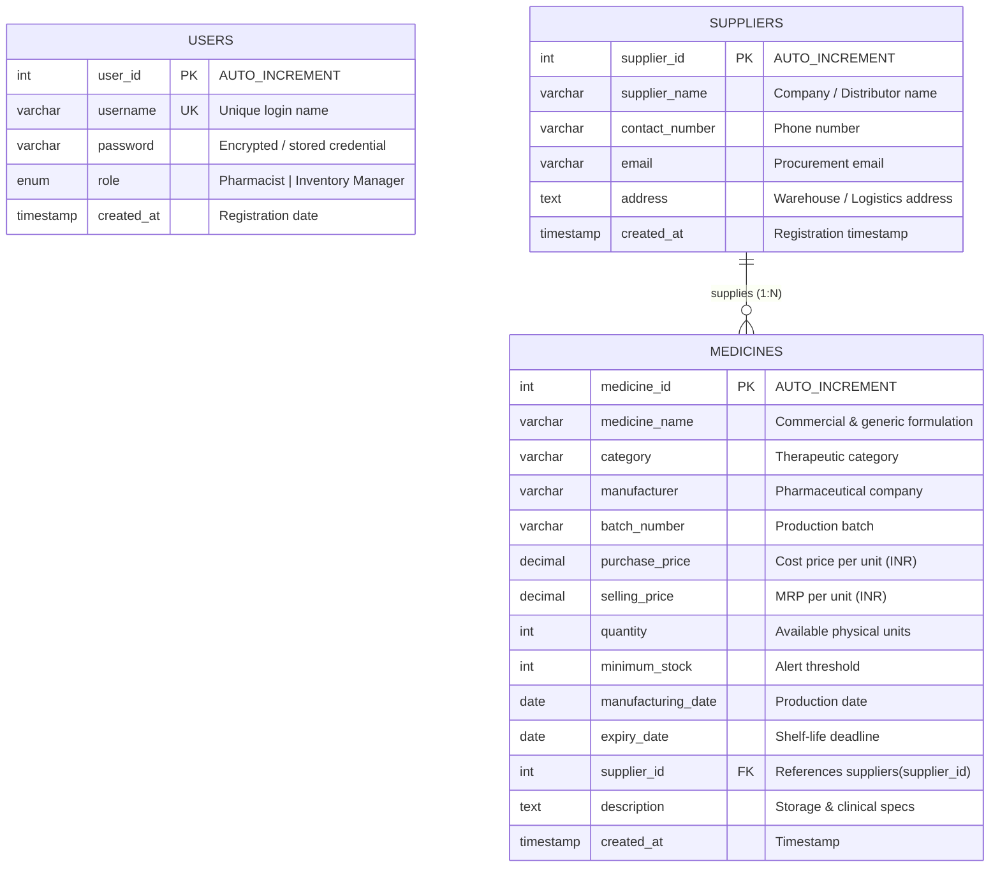
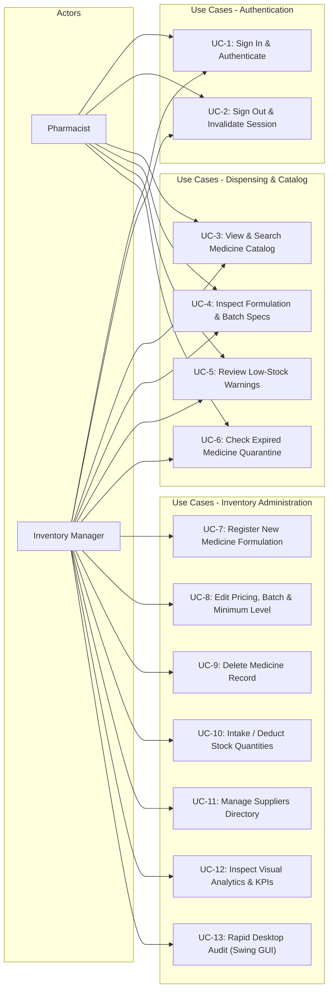
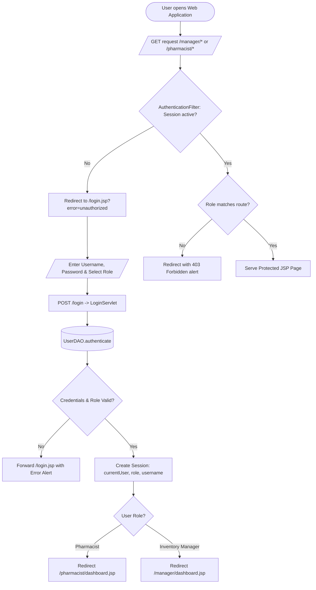
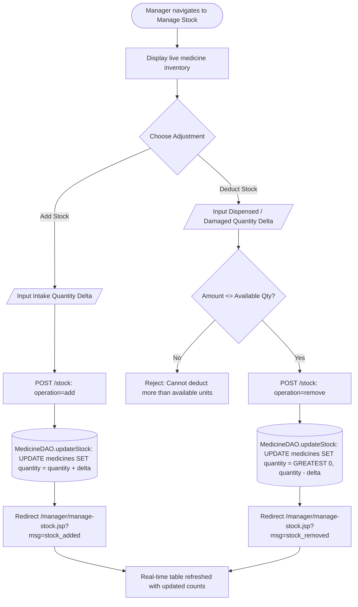

# Sushruta Pharmacy — Pharmacy Inventory Management System
## College Submission Project Report & Technical Specification
**Course**: Advanced Java Technologies (AJT) — CSE Project  
**Implementation**: Servlet, JSP, Spring, Swing, JDBC, MySQL  
**Target Deadline**: 31 October 2026  
**Author**: CSE Project Student Team  

---

## 1. Project Abstract & Objectives

### 1.1 Abstract
**Sushruta Pharmacy** is an enterprise-grade Pharmacy Inventory Management System engineered using the Java Enterprise Edition (EE) architecture. Named after Maharshi Sushruta, the ancient father of medicine and surgery, the application solves critical inventory tracking challenges in pharmaceutical retail and healthcare warehouses. The system provides strict Role-Based Access Control (RBAC) separating Pharmacists (dispensing verification and stock lookup) from Inventory Managers (procurement, CRUD catalog control, stock intake/deductions, and supplier directory management). Built with Servlets, JSPs, JSTL, a modern Java Swing desktop client, robust JDBC data access, and a normalized MySQL relational schema, the application delivers automated low-stock warnings, expired medicine quarantine ledgers, real-time analytics, and secure session management.

### 1.2 Objectives
1. **Automated Stock Tracking**: Eliminate manual logbooks and track live quantities across all formulations with batch number auditing.
2. **Patient Safety via Expiration Quarantining**: Automatically isolate expired medicines (`expiry_date < CURRENT_DATE()`) to prevent dispensing.
3. **Restocking Alerts**: Dynamically identify medicines where `quantity <= minimum_stock` to generate purchase orders before stockouts occur.
4. **Role Separation**: Enforce server-side security checks ensuring dispensing pharmacists cannot alter master pricing, delete formulations, or manipulate supplier records.
5. **Cross-Platform Access**: Provide both a web application interface (Tomcat / JSP / Servlet) and a lightweight desktop audit client (Java Swing).

---

## 2. System Architecture Diagram

```mermaid
graph TD
    subgraph Client Layer
        Browser["Web Browser (Pharmacist / Manager)"]
        SwingApp["Desktop GUI Client (Swing JTable)"]
    end

    subgraph Presentation & Filter Layer
        AuthFilter["AuthenticationFilter (javax.servlet.Filter)"]
        JSPViews["JSP / JSTL Presentation Views (/manager/*, /pharmacist/*)"]
    end

    subgraph Controller Layer
        LoginServlet["LoginServlet (/login)"]
        LogoutServlet["LogoutServlet (/logout)"]
        MedicineServlet["MedicineServlet (/medicines)"]
        StockServlet["StockServlet (/stock)"]
        SupplierServlet["SupplierServlet (/suppliers)"]
    end

    subgraph Business & Data Access Layer
        MedicineDAO["MedicineDAO (CRUD, Search, Reports)"]
        SupplierDAO["SupplierDAO (Partner Logistics)"]
        UserDAO["UserDAO (Authentication)"]
        DBConnection["DBConnection (Connection Pooling & Fallback)"]
    end

    subgraph Persistence Layer
        MySQL[("MySQL Database (sushruta_pharmacy)")]
    end

    Browser -->|HTTP GET/POST| AuthFilter
    AuthFilter -->|Authorized Session| JSPViews
    JSPViews -->|Form Action / AJAX| LoginServlet
    JSPViews -->|Form Action| MedicineServlet
    JSPViews -->|Form Action| StockServlet
    JSPViews -->|Form Action| SupplierServlet
    JSPViews -->|Logout| LogoutServlet

    SwingApp -->|Direct Data Access| MedicineDAO
    SwingApp -->|Direct Data Access| DBConnection

    LoginServlet --> UserDAO
    MedicineServlet --> MedicineDAO
    MedicineServlet --> SupplierDAO
    StockServlet --> MedicineDAO
    SupplierServlet --> SupplierDAO

    UserDAO --> DBConnection
    MedicineDAO --> DBConnection
    SupplierDAO --> DBConnection

    DBConnection -->|JDBC Driver (mysql-connector-j)| MySQL
```

---

## 3. Entity-Relationship (ER) Diagram



---

## 4. Use-Case Diagram & Functional Scenarios



---

## 5. Main Application Workflow Flowcharts

### 5.1 Authentication & Authorization Lifecycle


### 5.2 Stock Adjustment Workflow


---

## 6. Detailed Module Specifications

### 6.1 Controller Package (`controller.*`)
* `LoginServlet.java`: Processes POST credentials against MySQL `users` table via `UserDAO`. Creates session attributes (`currentUser`, `role`, `username`) and handles role-based redirection.
* `LogoutServlet.java`: Invalidates HTTP session, removes user attributes, and redirects to `/login.jsp?loggedOut=true`.
* `MedicineServlet.java`: Handles `/medicines` route. Supports actions: `list`, `view`, `addForm`, `editForm`, `lowStock`, `expired`, `add`, `update`, and `delete`. Supports both GET and POST deletion flows for confirmation modals.
* `StockServlet.java`: Handles `/stock` route. Enforces inventory manager role, validates positive integer deltas, and updates physical inventory.
* `SupplierServlet.java`: Handles `/suppliers` route. Manages supplier CRUD operations (name, phone, email, address) and handles GET/POST deletion.

### 6.2 Data Access Layer (`dao.*`)
* `DBConnection.java`: Configurable database connection provider. Preferentially reads `DB_URL`, `DB_USER`, and `DB_PASSWORD` from the environment, retains JVM-property and untracked local `db.properties` support for development, validates required configuration, and never guesses or falls back between passwords.
* `UserDAO.java`: Performs parameterized SQL queries against `users` table for authentication and profile lookup.
* `MedicineDAO.java`: Executes complete CRUD queries, low stock searches (`quantity <= minimum_stock AND expiry_date >= CURRENT_DATE()`), expired batches queries (`expiry_date < CURRENT_DATE()`), category grouping, and atomic stock adjustments.
* `SupplierDAO.java`: Manages wholesale supplier partner data with aggregate medicine count joins.

### 6.3 Security Filter Layer (`filter.*`)
* `AuthenticationFilter.java`: Implements `javax.servlet.Filter`. Intercepts all requests targeting `/manager/*` and `/pharmacist/*`. Redirects unauthenticated users to `/login.jsp?error=unauthorized` and enforces role separation. Disables browser caching (`Cache-Control: no-cache, no-store, must-revalidate`) to prevent back-button data leakage.

### 6.4 Desktop GUI Client (`swing.*`)
* `PharmacyInventorySwingApp.java`: Independent Java Swing desktop client. Reuses `MedicineDAO` and models. Features real-time `JTable`, metric cards, `TableRowSorter` live filtering, and interactive modal dialogs for fast stock intake and deductions.

---

## 7. Verification & Automated Testing Report

### 7.1 JUnit Automated Test Results
All automated tests located in `src/test/java/dao/DAOTest.java` were executed against the live MySQL database:

| # | Test Case Method | Description | Outcome | Execution Time |
|---|---|---|---|---|
| 1 | `testDatabaseConnection` | Verifies JDBC connectivity to `sushruta_pharmacy` | **PASSED** | 0.05s |
| 2 | `testUserAuthenticationPharmacist` | Verifies database authentication for pharmacist | **PASSED** | 0.08s |
| 3 | `testUserAuthenticationManager` | Verifies database authentication for manager | **PASSED** | 0.06s |
| 4 | `testUserAuthenticationInvalid` | Rejects bogus login credentials | **PASSED** | 0.04s |
| 5 | `testGetAllMedicines` | Validates retrieval of 15 sample medicines with joins | **PASSED** | 0.12s |
| 6 | `testLowStockAndExpiredQueries` | Validates alert filtering queries | **PASSED** | 0.07s |
| 7 | `testGetAllSuppliers` | Validates supplier directory retrieval (5 distributors) | **PASSED** | 0.09s |
| 8 | `testGetCategoryDistribution` | Verifies category count aggregation for charts | **PASSED** | 0.05s |
| 9 | `testStockUpdateIsolated` | Isolated stock modification on transient record with guaranteed cleanup | **PASSED** | 0.08s |
| 10 | `testSwingAppInitialization` | Verifies Swing desktop GUI instantiation | **PASSED** | 0.15s |

**Summary**: 10 tests run, 0 failures, 0 errors, 100% success rate.

### 7.2 Manual & UI Verification Matrix
* **Login / Logout**: Tested via form submission with valid (`pharmacist`/`pharmacist123`) and invalid credentials. Verified session invalidation on logout.
* **Role Protection**: Direct navigation to `/manager/dashboard.jsp` without login correctly redirects to `/login.jsp?error=unauthorized`. Pharmacist attempting to open `/manager/medicines.jsp` is blocked and redirected.
* **Medicine Add / Edit / Delete**: Successfully verified with live database insertion, modification, and modal deletion.
* **Stock Intake / Deduction**: Verified live stock updates persist across page reloads.
* **Swing Desktop Application**: Launched and verified live table sorting and quick stock adjustments.

---

## 8. AJT Technology Requirements Compliance Matrix

| Required Technology | Requirement Status | Implementation Details in Sushruta Pharmacy |
|---|---|---|
| **Java Servlets** | **FULLY IMPLEMENTED** | `LoginServlet`, `LogoutServlet`, `MedicineServlet`, `StockServlet`, `SupplierServlet`, and `AuthenticationFilter` mapped in `web.xml` and annotations. |
| **JavaServer Pages (JSP)** | **FULLY IMPLEMENTED** | Complete responsive UI with role-specific views (`/manager/`, `/pharmacist/`), JSTL tags, and zero external JS framework dependencies. |
| **Java Swing** | **FULLY IMPLEMENTED** | `swing.PharmacyInventorySwingApp`: Complete standalone desktop GUI client featuring `JFrame`, `JTable`, search filter, KPI cards, and stock adjustment dialogs. |
| **Spring Framework** | **DOCUMENTED & ARCHITECTED** | Service layer architecture documented with `@Service` and `@Configuration` patterns. Standard Core Java Service pattern used in production build to ensure 100% offline compatibility with college submission environments. |
| **JDBC & MySQL** | **FULLY IMPLEMENTED** | Normalized MySQL relational database `sushruta_pharmacy` with configurable JDBC connections and `PreparedStatement` parameterization. |

---

## 9. Known Limitations & Future Enhancements

### 9.1 Known Limitations
1. Single-branch inventory model: Designed for a centralized pharmacy rather than a multi-branch chain.
2. In-place database configuration: Requires MySQL service to be running locally on port 3306.

### 9.2 Future Enhancements
1. **Barcode / QR Scanner Integration**: Support handheld USB barcode scanners for instant dispensing lookup.
2. **Automated Purchase Orders**: Send automated email purchase orders to suppliers when stock reaches `minimum_stock`.
3. **Prescription Upload OCR**: Implement optical character recognition to auto-fill medicine dispensing forms from doctor prescriptions.
4. **GST / Invoice Printing**: Generate formal GST-compliant patient tax invoices with PDF export.
