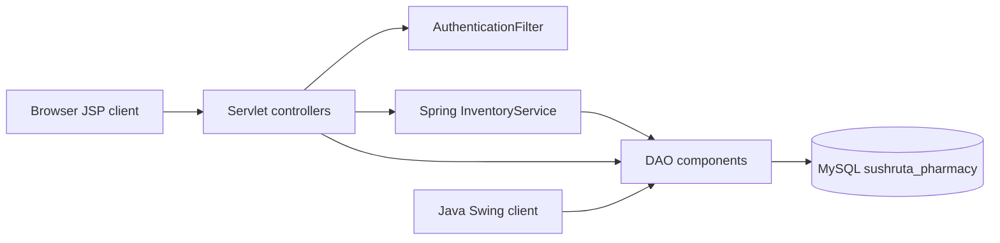
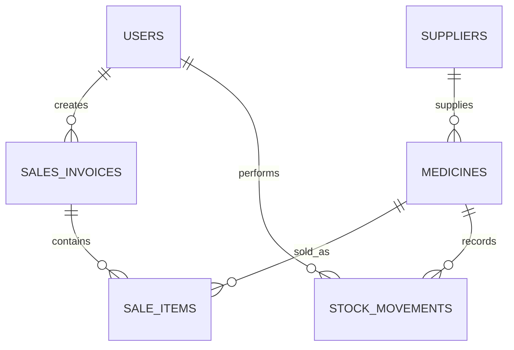
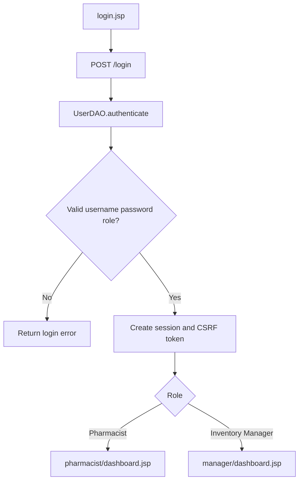
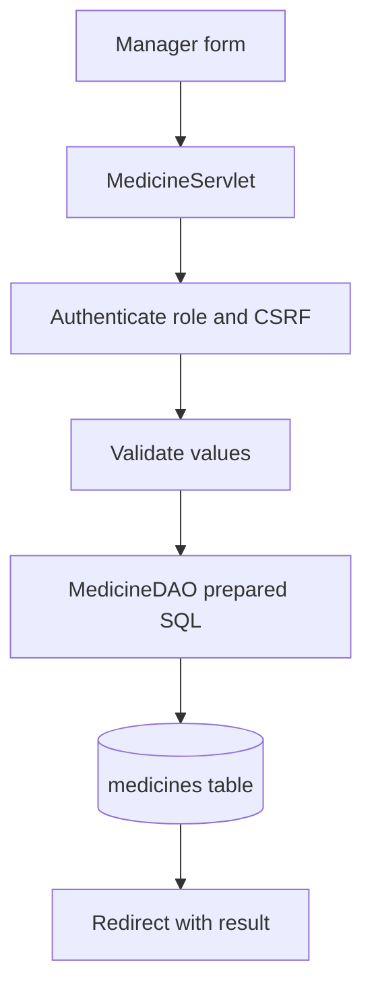
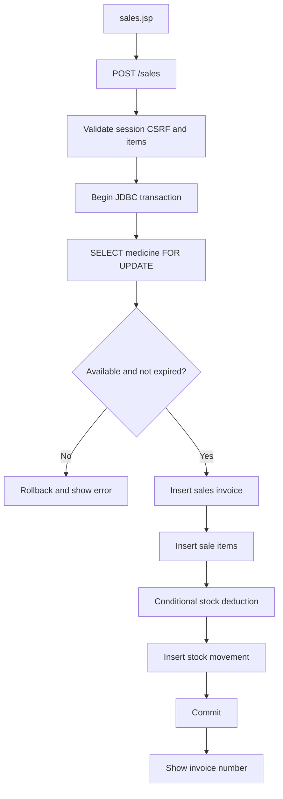
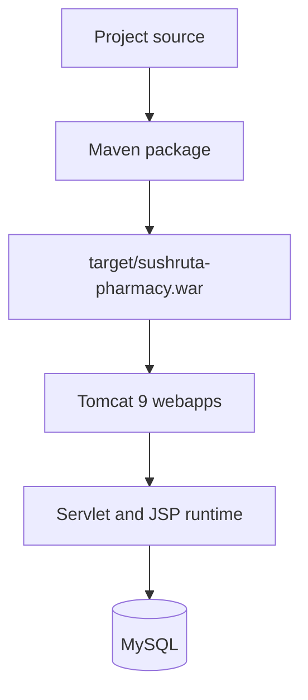

# Sushruta Pharmacy Architecture Diagrams

These diagrams reflect the current source implementation.

## System architecture

## Database relationships

## Login flow

## Medicine management flow

## Sales transaction flow

## Deployment flow

