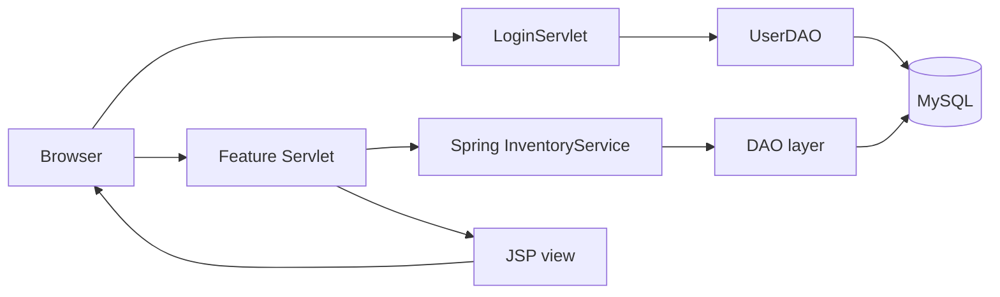
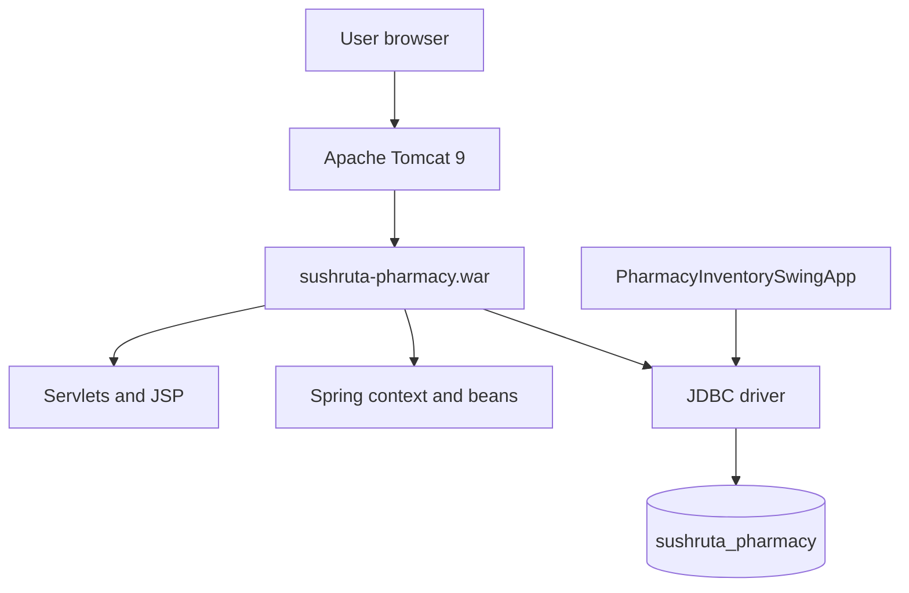
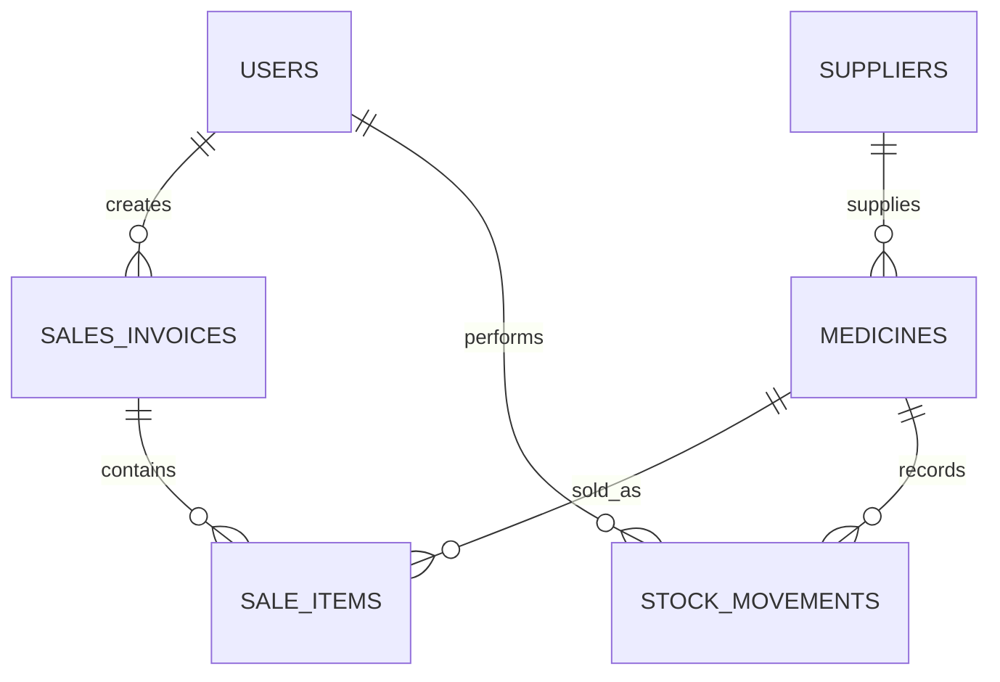
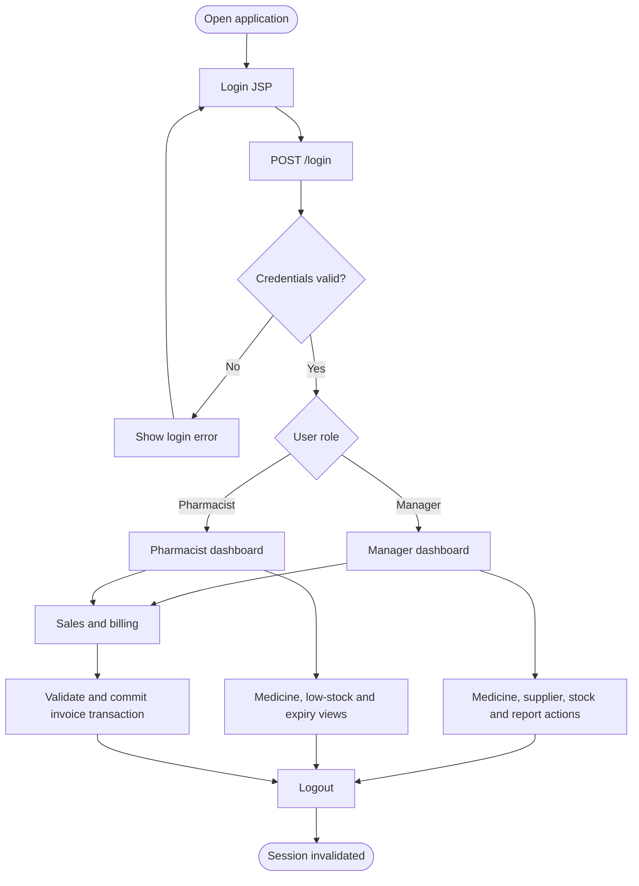

# Sushruta Pharmacy
## Pharmacy Inventory Management System

### Complete Project Report

**Academic project title:** AJT CSE Project: Implementation of AJT Technologies (Servlet, JSP, Spring, Swing)

**Project type:** Java web application with a Java Swing desktop client

**Packaging:** Maven WAR

**Report basis:** Source, configuration, SQL, tests, and generated WAR inspected from the repository. Browser/Tomcat demonstration was not performed during documentation.

## Executive Summary

Sushruta Pharmacy is an inventory management application for a pharmacy. It provides role-based login for pharmacists and inventory managers, medicine and supplier management, stock monitoring, expiry and low-stock views, inventory reports, sales billing, and a Swing inventory client. The web application uses Java Servlets, JSP, JDBC, MySQL, Spring Framework 5.3, JSTL, HTML, CSS and JavaScript. The desktop client reuses the JDBC DAO layer.

The verified source structure contains 20 Java files, 21 web resources including JSP pages, two SQL scripts, a Maven WAR configuration, a Spring application context, and one JUnit integration test class. Maven `clean package` completed successfully in the inspected environment and produced `target/sushruta-pharmacy.war`. The build log reported 10 tests with zero failures and zero errors. Those tests are database-dependent and include a temporary write cycle; they should be isolated from the production database before routine use.

The implementation is suitable as a college project foundation. Remaining limitations include limited sales UI functionality, JSP scriptlet usage, incomplete output escaping across older pages, limited sales reporting, no user-administration screen, and no verified browser deployment against a running Tomcat instance.

## Table of Contents

1. Introduction
2. Existing and Proposed System
3. Technology and Tools Used
4. System Requirements
5. System Architecture
6. Project Folder Structure
7. Database Design
8. Module-wise Explanation
9. Backend Working
10. Frontend Working
11. Complete Application Workflow
12. Installation and Configuration
13. Running the Project
14. Testing and Test Cases
15. Security and Validation
16. Current Limitations
17. Future Enhancements
18. Conclusion
19. References

# Chapter 1 - Introduction

## 1.1 Project Introduction

Pharmacies must maintain accurate information about medicines, suppliers, quantities, prices, expiry dates and stock thresholds. Manual registers and disconnected spreadsheets make it difficult to identify expired medicines, detect low stock, maintain supplier details and provide reliable inventory summaries.

Sushruta Pharmacy provides a centralized system for storing and viewing pharmacy inventory data. Authorized users log in according to their role. Inventory managers can maintain medicines, suppliers and stock. Pharmacists can view medicine availability, low-stock items, expiry alerts and medicine details. The application also contains a basic transaction-based sales module and a Swing desktop inventory client.

## 1.2 Problem Statement

The project addresses the risk of inaccurate or delayed pharmacy inventory information caused by manual entry, inconsistent records and weak stock visibility. The system is intended to reduce routine effort and make stock, supplier and expiry information available through a consistent application.

## 1.3 Objectives

- Authenticate users and separate pharmacist and inventory-manager access.
- Store medicine and supplier data in MySQL.
- Support medicine create, read, update and delete operations.
- Support supplier create, read, update and delete operations.
- Monitor quantity, minimum-stock threshold and expiry dates.
- Support safe stock adjustments.
- Provide inventory dashboard and report summaries.
- Provide a basic invoice and sales workflow.
- Demonstrate Servlet, JSP, Spring, JDBC, MySQL and Swing technologies.
- Produce a deployable WAR for Tomcat 9.

## 1.4 Scope

Implemented scope includes inventory, supplier, stock, expiry, low-stock, reports, login, role authorization, basic billing, Spring IoC and Swing inventory display. Online payments, barcode scanning, supplier purchasing, advanced analytics, user administration and production deployment automation are outside the verified current scope.

## 1.5 Target Users

- **Inventory Manager:** manages medicine records, suppliers and stock adjustments.
- **Pharmacist:** views available medicines, stock status, low-stock medicines and expired medicines, and can access the basic sales page according to the current servlet authorization.
- **Project administrator/developer:** configures MySQL, Maven and Tomcat and deploys the WAR.

# Chapter 2 - Existing and Proposed System

## 2.1 Existing Manual Problems

Manual pharmacy management commonly requires repeated register updates, manual calculations and visual checking of expiry dates. This can lead to duplicate data, missing supplier information, delayed restocking and difficulty preparing reports.

## 2.2 Proposed Computerized System

The proposed system stores shared records in MySQL and provides web and desktop access through JDBC. Servlets handle requests, JSP pages render screens, DAOs encapsulate SQL, Spring provides component discovery and dependency injection, and the Swing client provides a desktop inventory view.

## 2.3 Advantages

- Centralized medicine and supplier records.
- Role-based navigation and server-side authorization checks.
- Prepared statements for database operations.
- Low-stock and expiry queries based on current database values.
- Transactional sales processing with stock validation and rollback.
- Reusable model and DAO classes shared by web and Swing code.
- WAR packaging for Tomcat deployment.

# Chapter 3 - Technology and Tools Used

| Technology | Actual use in this project |
|---|---|
| Java | Models, Servlets, DAOs, Spring services, security utilities and Swing client. |
| Java Servlet API 4.0.1 | `LoginServlet`, `MedicineServlet`, `StockServlet`, `SupplierServlet`, `SalesServlet` and `LogoutServlet`. |
| JSP 2.3.3 | Login, manager, pharmacist and sales screens. |
| Spring Framework 5.3.39 | `ContextLoaderListener`, component scanning, `@Service`, `@Repository` and `InventoryService` dependency injection. |
| JDBC | `DBConnection` and DAO SQL operations using `PreparedStatement`. |
| MySQL Connector/J 8.0.33 | MySQL database connection. |
| MySQL | Users, suppliers, medicines and additive sales tables. |
| XAMPP | Expected local MySQL service provider. |
| Apache Tomcat 9 | Target servlet container for the `javax.servlet` application. |
| Maven | Dependency management, compilation, tests and WAR packaging. |
| JSTL 1.2 | JSTL core tag library declarations in JSP pages; the WAR includes `jstl-1.2.jar`. |
| HTML/CSS | Page structure and visual design. |
| JavaScript | Client-side search, confirmation dialogs, table interaction and form behavior. |
| Swing | Desktop inventory audit application. |
| JDK 22 | Development runtime; source and target compatibility are configured as Java 11. |
| VS Code | Development environment specified for the project. |

The project deliberately uses the `javax.servlet` namespace and Spring 5.3 rather than a Jakarta-only stack, matching Tomcat 9 compatibility.

# Chapter 4 - System Requirements

## 4.1 Hardware

- Dual-core processor or better.
- 4 GB RAM minimum; 8 GB recommended for VS Code, XAMPP and Tomcat together.
- At least 2 GB free disk space for JDK, Maven repository, Tomcat and project artifacts.
- Network connectivity is useful for initial Maven dependency download.

## 4.2 Software

- Windows 11 or compatible Windows environment.
- JDK 22 installed and available on `PATH`.
- Maven 3.10.0 or compatible Maven release.
- XAMPP with MySQL/MariaDB service.
- Apache Tomcat 9.0.x.
- VS Code with Java support extensions.
- A modern browser for the web application.

## 4.3 Database and Server

The application expects database `sushruta_pharmacy`, normally on `localhost:3306`. The application uses a WAR context deployed by Tomcat. `DBConnection` resolves `DB_URL`, `DB_USER`, and `DB_PASSWORD` environment variables first, then JVM properties `db.url`, `db.user`, and `db.password`, then the untracked local `db.properties` file. The real file is ignored by Git and excluded from the WAR; `db.properties.example` contains placeholders only.

# Chapter 5 - System Architecture

## 5.1 Architecture Overview

The application follows a practical layered architecture:

1. Browser or Swing UI sends an action.
2. Servlet or Swing event handler receives the action.
3. The service layer is available for Spring-managed application operations.
4. DAO classes perform JDBC operations.
5. MySQL stores persistent data.
6. JSP or Swing renders the result.

The web layer is not a pure MVC implementation because several JSP pages still instantiate DAOs directly as a fallback. The primary servlet paths do forward request data to JSP pages, but the older direct-JSP behavior remains in some screens.

## 5.2 Spring Architecture

`web.xml` registers `ContextLoaderListener` with `classpath:applicationContext.xml`. The context scans `service,dao`. `InventoryService` is annotated with `@Service`; `MedicineDAO`, `SupplierDAO`, `SalesDAO` and `UserDAO` are annotated with `@Repository`. Spring injects `MedicineDAO` and `SupplierDAO` through the `InventoryService` constructor. `StockServlet` obtains the Spring-managed service from the web application context.

## 5.3 Request and Response Flow



## 5.4 Deployment Architecture



# Chapter 6 - Complete Project Folder Structure

```text
inventory_manang_mant/
|-- pom.xml
|-- README.md
|-- PROJECT_SUBMISSION_REPORT.md
|-- database/
|   |-- schema.sql
|   `-- migration_001_sales_and_stock_history.sql
`-- src/
    |-- main/
    |   |-- java/
    |   |   |-- controller/
    |   |   |-- dao/
    |   |   |-- filter/
    |   |   |-- model/
    |   |   |-- security/
    |   |   |-- service/
    |   |   `-- swing/
    |   |-- resources/
    |   |   |-- applicationContext.xml
    |   |   |-- db.properties.example
    |   |   `-- db.properties (local only, ignored)
    |   `-- webapp/
    |       |-- css/style.css
    |       |-- js/script.js
    |       |-- manager/
    |       |-- pharmacist/
    |       |-- login.jsp
    |       |-- sales.jsp
    |       `-- WEB-INF/web.xml
    `-- test/java/dao/DAOTest.java
```

## 6.1 Important Files

- `pom.xml`: WAR packaging, Servlet/JSP/JSTL/MySQL/Spring/JUnit dependencies.
- `web.xml`: Spring listener, session configuration, filter mappings and error pages.
- `applicationContext.xml`: Spring component scanning configuration.
- `db.properties.example`: placeholder configuration template. The real `db.properties` is local-only, ignored by Git, and excluded from the WAR.
- `controller/`: HTTP request handlers.
- `dao/`: JDBC persistence classes.
- `model/`: serializable domain objects.
- `security/`: PBKDF2 password, CSRF and HTML escaping utilities.
- `service/`: Spring-managed business service.
- `swing/`: desktop inventory client.
- `database/`: initial schema and additive migration.

# Chapter 7 - Database Design

## 7.1 Existing Core Tables

### users

Defined in `schema.sql`. Columns are `user_id` primary key, unique `username`, `password`, `role` and `created_at`. Roles are `Pharmacist` and `Inventory Manager` in the supplied schema.

### suppliers

Columns are `supplier_id` primary key, `supplier_name`, `contact_number`, `email`, `address` and `created_at`.

### medicines

Columns are `medicine_id` primary key, `medicine_name`, `category`, `manufacturer`, `batch_number`, `purchase_price`, `selling_price`, `quantity`, `minimum_stock`, `manufacturing_date`, `expiry_date`, nullable `supplier_id`, `description` and `created_at`.

`medicines.supplier_id` references `suppliers.supplier_id` with `ON DELETE SET NULL`.

## 7.2 Additive Sales Tables

The migration creates `sales_invoices`, `sale_items` and `stock_movements` with `CREATE TABLE IF NOT EXISTS`. It does not insert or alter existing records.

- `sales_invoices`: invoice number, user, subtotal, discount, total and creation timestamp.
- `sale_items`: invoice line, medicine, quantity, unit price and line total.
- `stock_movements`: medicine, user, movement type, quantity before and after movement, optional reference and timestamp.

## 7.3 Relationships



## 7.4 Database Connection

`DBConnection` prefers environment variables, then JVM properties, then the local `db.properties` file. It loads the MySQL driver, validates required configuration, does not guess passwords, and returns JDBC connections. DAOs use try-with-resources for connections, statements and result sets.

## 7.5 Database Safety

`schema.sql` is an initial setup script and contains table drops for clean recreation. It must not be run against an existing production database. The sales migration is additive and is the appropriate script for an existing installation.

# Chapter 8 - Module-wise Explanation

## 8.1 Login and Authentication

`login.jsp` submits credentials to `/login`. `LoginServlet` validates required fields and calls `UserDAO.authenticate`. Legacy plain-text passwords can be verified and upgraded to PBKDF2 by `PasswordUtil`. On success, the servlet stores the current user, role, username and CSRF token in the session, then redirects according to role.

## 8.2 Authorization and Sessions

`AuthenticationFilter` protects `/manager/*` and `/pharmacist/*`, checks the current session user and enforces manager-route restrictions. Servlets also check session authentication and role before state-changing actions. Logout invalidates the session.

## 8.3 Manager Dashboard

`manager/dashboard.jsp` displays total medicines, total stock, low-stock count, expired count and recent inventory records. It links to medicine, supplier, stock and report screens. The dashboard is protected by the authentication filter.

## 8.4 Pharmacist Dashboard

`pharmacist/dashboard.jsp` provides read-oriented medicine and alert views. Pharmacists cannot use manager routes and are rejected by backend role checks for manager-only mutation operations.

## 8.5 Medicine Management

`MedicineServlet` supports list, view, add form, edit form, low-stock and expired actions. `MedicineDAO` implements selection, search, insert, update, delete, counts, category distribution and stock operations. Manager forms submit to `/medicines` and use CSRF tokens.

## 8.6 Supplier Management

`SupplierServlet` and `SupplierDAO` provide supplier listing and CRUD operations. Supplier records include name, contact number, email, address and a computed medicine count.

## 8.7 Stock Management

`StockServlet` supports manager stock adjustments and read-only pharmacist listing. The sales DAO uses row locking and a conditional update to prevent insufficient stock. The migration provides the table needed to record future stock movement history. Manual stock adjustment history should be expanded further if audit-grade traceability is required.

## 8.8 Sales and Billing

`SalesServlet` loads available non-expired medicines and recent invoices. It accepts medicine IDs, quantities and an optional discount. `SalesDAO` starts a transaction, locks each medicine row, checks expiry and quantity, creates the invoice and line items, deducts stock conditionally, records a stock movement, and commits. Any failure rolls back the full sale.

The current UI is a basic invoice form and recent-invoice listing. It is not a full shopping-cart interface with multiple dynamically added rows or printable invoice template.

## 8.9 Reports

`manager/reports.jsp` uses DAO counts, category distribution and recently added medicines. It is an inventory report. Sales history is displayed on `sales.jsp`; a separate advanced sales-report screen is not verified.

## 8.10 Swing Client

`PharmacyInventorySwingApp` extends `JFrame`, loads medicines through `MedicineDAO`, displays a searchable table, calculates metrics and supports quick stock adjustment actions. It uses the same JDBC configuration and database schema as the web application.

# Chapter 9 - Backend Working

## 9.1 Servlet Responsibilities

- `LoginServlet`: credential validation and role redirect.
- `LogoutServlet`: session invalidation.
- `MedicineServlet`: medicine navigation and CRUD.
- `SupplierServlet`: supplier navigation and CRUD.
- `StockServlet`: stock view and adjustment.
- `SalesServlet`: invoice creation and recent sales view.

## 9.2 DAO Responsibilities

DAOs contain SQL and map `ResultSet` rows to model objects. The code consistently uses prepared statements for user-supplied values. `MedicineDAO` joins suppliers for display fields. `SalesDAO` owns the multi-step sale transaction.

## 9.3 Transaction Example

For a sale, the backend performs the following in one transaction:

1. Lock each requested medicine row with `FOR UPDATE`.
2. Reject missing, expired or insufficient-stock medicines.
3. Calculate subtotal, discount and total.
4. Insert the invoice.
5. Insert each sale item.
6. Deduct stock only where the required quantity remains available.
7. Insert stock movement records.
8. Commit, or roll back every step if any operation fails.

## 9.4 Exception Handling

DAO methods generally return empty lists or false on SQL errors and print stack traces. This is functional for a college prototype but should be replaced with structured logging and user-safe error handling for production.

# Chapter 10 - Frontend Working

The JSP frontend is organized by role under `manager/` and `pharmacist/`. Shared visual styling is in `css/style.css`; client behavior is in `js/script.js`. Pages contain navigation sidebars, dashboard cards, tables, forms and action buttons.

The current UI combines JSTL declarations with Java scriptlets. This works in the existing WAR, which contains `jstl-1.2.jar`, but a cleaner long-term implementation would move data preparation out of JSP and use EL/JSTL consistently. Output escaping should be standardized across all existing pages.

Forms communicate with Servlets using POST requests. Hidden CSRF tokens are now included for state-changing actions. Success and error messages are conveyed through query parameters after redirects.

# Chapter 11 - Complete Application Workflow



# Chapter 12 - Installation and Configuration

1. Install JDK 22 and verify `java -version`.
2. Install Maven 3.10.0 and verify `mvn -version`.
3. Install XAMPP and start MySQL.
4. Install Apache Tomcat 9.0.x.
5. Open the project root containing `pom.xml` in VS Code.
6. Confirm the database name is `sushruta_pharmacy`.
7. Prefer setting `DB_URL`, `DB_USER`, and `DB_PASSWORD`. For local IDE execution only, copy `src/main/resources/db.properties.example` to the ignored `src/main/resources/db.properties`. The real file is excluded from the WAR.
8. For an existing database, apply only `database/migration_001_sales_and_stock_history.sql` for sales tables. Do not run destructive portions of `schema.sql` against existing data.

# Chapter 13 - How to Run the Project

## 13.1 Build

From the directory containing `pom.xml`:

```text
mvn clean package
```

The result is `target/sushruta-pharmacy.war`.

## 13.2 Deploy

1. Stop Tomcat if it is running.
2. Copy the WAR to Tomcat's `webapps` directory.
3. Start Tomcat.
4. Open `http://localhost:8080/sushruta-pharmacy/` if the default connector port is 8080.
5. If deployment fails, inspect Tomcat `logs/catalina.*.log`, `localhost.*.log`, `work` and `temp` permissions.

The URL and browser deployment were not verified in this documentation run, so the port and context URL remain environment-dependent.

## 13.3 Credentials

The supplied initial schema contains sample users. Credentials are intentionally not repeated in this report. Use the credentials configured in the database, and change them before any public or shared deployment.

# Chapter 14 - Testing and Test Cases

## 14.1 Automated Test Evidence

The inspected `mvn clean package` build reported:

- Tests run: 10
- Failures: 0
- Errors: 0
- Skipped: 0
- WAR build: successful

The test class is `src/test/java/dao/DAOTest.java`. It tests connection, user authentication, medicine queries, supplier queries, category distribution, isolated stock update behavior and Swing initialization.

Because the test uses the configured JDBC connection and inserts/deletes a temporary medicine, it must be configured against a dedicated test database before future execution.

## 14.2 Test Case Matrix

| ID | Module | Scenario | Expected result | Actual evidence | Status |
|---|---|---|---|---|---|
| T01 | Database | Open JDBC connection | Connection opens | DAOTest passed in Maven build | Passed |
| T02 | Login | Valid pharmacist credentials | User returned with pharmacist role | DAOTest passed | Passed |
| T03 | Login | Valid manager credentials | User returned with manager role | DAOTest passed | Passed |
| T04 | Login | Invalid credentials | Null user | DAOTest passed | Passed |
| T05 | Medicine | Load all medicines | Non-empty list | DAOTest passed | Passed |
| T06 | Inventory | Low-stock and expired queries | Non-null lists | DAOTest passed | Passed |
| T07 | Supplier | Load suppliers | Non-empty list | DAOTest passed | Passed |
| T08 | Reports | Category distribution | Non-empty map | DAOTest passed | Passed |
| T09 | Stock | Add and deduct temporary stock | Correct quantities and cleanup | DAOTest passed | Passed |
| T10 | Swing | Initialize app in non-headless mode | JFrame initializes | DAOTest passed where applicable | Passed |
| T11 | Browser | JSP navigation and Tomcat deployment | Pages render and actions work | Not executed | Not verified |
| T12 | Sales | Invoice transaction against migrated DB | Invoice, items and stock movement commit atomically | Not executed | Not verified |

# Chapter 15 - Security and Validation

## Implemented

- Session-based authentication.
- Manager/pharmacist role checks in filter and servlets.
- Prepared statements for SQL values.
- PBKDF2 password hashing and legacy migration path.
- CSRF utility and tokens on current state-changing forms.
- Sales row locking and conditional stock deduction.
- HTML escaping utility used by the sales page.
- Cache-control headers on protected filtered pages.

## Remaining Security Work

- Existing JSP pages still contain many raw scriptlet outputs and should be systematically escaped.
- The local `db.properties` file is a development fallback only; deployment should use environment variables or JVM properties. It is ignored by Git and excluded from the WAR.
- Login should regenerate the session ID after authentication to reduce session-fixation risk.
- Logout should preferably be POST-only with CSRF protection.
- Structured logging should replace `printStackTrace`.
- The test database must be separated from the application database.

# Chapter 16 - Current Limitations

- No browser/Tomcat deployment was verified in this documentation run.
- Sales UI is basic and does not provide a polished dynamic cart or printable invoice page.
- Sales reports are limited to recent invoice listing.
- No user-management CRUD screen exists.
- JSP pages mix view rendering with DAO calls and scriptlets.
- Existing DAO tests can write to whichever database is configured.
- No external backup/recovery workflow is implemented.
- No barcode, payment gateway or notification integration is implemented.
- The Maven build emits a MySQL coordinate relocation warning and a Java `-source/-target` warning; neither prevented the successful WAR build.

# Chapter 17 - Future Enhancements

The following are proposed enhancements, not claims about current implementation:

- Barcode scanning and medicine lookup.
- Printable and downloadable invoice documents.
- Daily, monthly and user-filtered sales reports.
- Expiry and low-stock notifications.
- Supplier purchase-order workflow.
- User administration and password-reset workflow.
- Database connection pooling.
- Centralized validation and structured application logging.
- Migration tooling with version tracking.
- Automated browser tests.
- Backup, restore and disaster-recovery procedures.
- Jakarta migration when the deployment server is upgraded to Tomcat 10 or later.

# Chapter 18 - Conclusion

Sushruta Pharmacy demonstrates a practical Java full-stack pharmacy inventory system using the technologies specified by the academic project title. The application has a clear set of inventory, supplier, stock and reporting modules, a role-aware web interface, a Swing client, JDBC persistence and a Spring IoC integration. The current Maven build produces a deployable WAR and the automated test suite completed without reported failures in the inspected build.

The application should be presented as a college project prototype rather than a production pharmacy platform until browser deployment, isolated database testing, systematic JSP escaping, sales UI refinement and operational hardening are completed.

# Chapter 19 - References

- Oracle Java documentation: https://docs.oracle.com/en/java/
- Apache Tomcat 9 documentation: https://tomcat.apache.org/tomcat-9.0-doc/
- Spring Framework reference documentation: https://docs.spring.io/spring-framework/docs/5.3.x/reference/html/
- Apache Maven documentation: https://maven.apache.org/guides/
- MySQL Reference Manual: https://dev.mysql.com/doc/refman/8.0/en/
- JSTL specification and tag library documentation: https://jakarta.ee/specifications/tags/
- Java Servlet specification: https://jakarta.ee/specifications/servlet/
